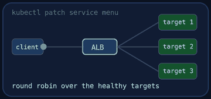
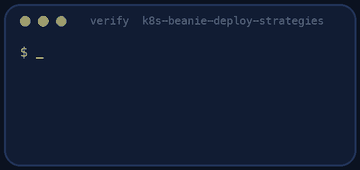
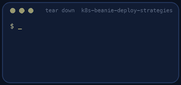

<p align="center"></p>

| | |
|-|-|
| **Time** | 90-105 min |
| **Cost** | free on a local cluster |
| **You need** | Docker, kubectl, git, curl, Python 3 and a local Kubernetes cluster (kind, OrbStack or Docker Desktop) running |

## How this lab works

1. **Fork** this repository to your own GitHub account (button at the top right).
2. Clone **your fork** in your Ubuntu environment (WSL on Windows, your OrbStack machine on Mac).
3. Read the lab below (the same text is in [`LAB.md`](LAB.md)) and follow the mission.
4. Answer the questions in [`SUBMISSION.md`](SUBMISSION.md). Where a question asks for output, paste it in a code block. No screenshots needed.
5. Commit and push. Open the **Actions** tab of your fork (click *I understand my workflows, go ahead and enable them* the first time). The **Lab check** shows what is still missing.
6. When the check is green, **submit the URL of your fork** in the course platform.

> [!NOTE]
> The check only looks at your answers and any files the lab asks you to commit. Your instructor reads your work and may ask you to explain any line.

<p align="center"></p>

## 🎬 The situation

<p align="center"></p>

Menu 2.0.0 is built, tested and approved. The lunch rush starts in an hour. Last time somebody ran `kubectl apply` on a new version, the old pods died before the new ones were ready, the app showed an error for forty seconds, and the owner called the CEO.

There is no single right way to release. Pick your road, or take all three, because each one protects you from a different mistake:

| Road | How | What it protects you from |
|------|-----|---------------------------|
| **Rolling update** | replace the pods a few at a time | *downtime*. Cheap, built into Kubernetes |
| **Blue/green** | run the new version next to the old one, flip a switch | *a risky cutover*, with an instant way back |
| **Canary** | give the new version a small share of real traffic first | *a bug that only appears in production* |

A checker sends **steady traffic from inside the cluster** while you release, and counts every dropped request and every version it sees. Each road has a number to hit.

> [!IMPORTANT]
> **Your mission**
> - Write a rolling update that drops no request, and use it to release 2.0.0, then roll it back
> - Run blue and green together and flip between them with one command, in both directions
> - Run a 9:1 canary and measure how much traffic the new version really gets
> - Tear down and prove it

**Time:** 90-105 min | **Cost:** free on a local cluster | **You need:** Docker, `kubectl`, git, curl, Python 3 and a local Kubernetes cluster running (kind, OrbStack or Docker Desktop with Kubernetes enabled). Check with `kubectl get nodes`.

<p align="center"></p>

## Part 0 - Set the scene

Fork this repository, clone your fork and run:

```bash
./setup.sh
kubectl get pods -n beanie-deploy
```

It builds the Beanie image and starts a **client pod** in the namespace `beanie-deploy`. Everything you do happens there. One trick makes the whole lab possible: Beanie reports its version at `/healthz`, taken from the environment variable `APP_VERSION`. Same image, different `APP_VERSION`, and you can tell "version 1" from "version 2" in every response. Read `common/probe.py`: it sends requests from inside the cluster at a steady rate and counts the versions it sees and the failures.

<p align="center"></p>

## Part 1 - Rolling update

<p align="center"></p>

Write `rolling/menu.yaml` (the comments specify it): a Deployment `menu` with 4 replicas, `APP_VERSION=1.0.0`, a readiness probe, and

```yaml
strategy:
  type: RollingUpdate
  rollingUpdate:
    maxSurge: 1
    maxUnavailable: 0
```

plus a Service `menu`. Apply it, then in one terminal run the probe, and in another release version 2:

```bash
kubectl exec -i -n beanie-deploy deploy/client -- python - 60 5 < common/probe.py
kubectl set env deployment/menu APP_VERSION=2.0.0 -n beanie-deploy
kubectl rollout status deployment/menu -n beanie-deploy
```

`maxSurge: 1` lets Kubernetes start **one extra** pod; `maxUnavailable: 0` forbids taking any old pod away until a new one is **Ready**. With a correct readiness probe, there is always a full set of working pods behind the Service. Without the probe, "started" would count as "ready" and requests would reach a pod that is still booting.

**A surprise you should expect.** Run the probe for the whole rollout and count the failures. Even with `maxUnavailable: 0` and a perfect readiness probe, a handful of requests (one or two percent) usually fail. Do not guess: when Kubernetes removes an old pod it does two things *at the same time*, it sends the pod `SIGTERM` and it tells the endpoints controller to stop routing to it. Every node's proxy learns about the second one a moment later. In that gap the Service still sends requests to a pod that is already shutting down. The cure is **graceful shutdown**: a `preStop` hook that sleeps for a few seconds keeps the pod serving until every node has caught up, and `terminationGracePeriodSeconds` must be longer than that sleep:

```yaml
spec:
  terminationGracePeriodSeconds: 30
  containers:
    - name: menu
      lifecycle:
        preStop:
          exec:
            command: ["sleep", "8"]
```

Add it, repeat the release (set `APP_VERSION` back to `1.0.0` first, then to `2.0.0`) and watch the failures drop to zero.

> [!NOTE]
> **Predict** The probe will show both versions during the rollout. For roughly how long? What would the numbers look like if `maxUnavailable` were `50%` and the readiness probe were missing?

Then roll back: `kubectl rollout undo deployment/menu -n beanie-deploy`. Kubernetes keeps the previous ReplicaSet; the rollback is another rolling update, in reverse.

<p align="center"></p>

## Part 2 - Blue/green

Delete the rolling deployment (`kubectl delete -f rolling/menu.yaml`). In `bluegreen/` write three files (the README lists them): `menu-blue` (3 replicas, version 1.0.0), `menu-green` (3 replicas, version 2.0.0), and one Service `menu` whose selector is `app: menu` **and** `track: blue`.

Both versions run in full at the same time. Only the Service decides who gets traffic. Run the probe and flip the selector with one command:

```bash
kubectl patch service menu -n beanie-deploy -p '{"spec":{"selector":{"app":"menu","track":"green"}}}'
```

Watch the probe: no failures, and from that moment only version 2.0.0 answers. A rollback is the same command with `blue`. It is instant, because green was already running and warmed up. What it costs: you pay for **twice** the pods during the release, and anything the two versions share (a database) must work with both.

> [!NOTE]
> **Think** The blue pods are still running after the switch. Why do teams keep them for a while? When do you finally delete them?

<p align="center"></p>

## Part 3 - Canary

Delete the blue/green objects. In `canary/` write `menu-stable` (9 replicas, version 1.0.0), `menu-canary` (1 replica, version 2.0.0) and a Service `menu` whose selector is just `app: menu`: it matches **all ten** pods, whatever their version. The Service spreads connections over the pods, so the canary receives about a tenth of the traffic.

```bash
kubectl exec -i -n beanie-deploy deploy/client -- python - 45 6 < common/probe.py
```

Count the share of 2.0.0. It will not be exactly 10%: each request picks a pod at random, so over a few hundred requests it wobbles. Abort the canary with `kubectl scale deployment/menu-canary --replicas=0`, and check that no 2.0.0 answer remains.

> [!NOTE]
> **Think** Replica ratios give you 10%, 20%, 33%... only in steps of one pod. How would you send exactly 1% of the traffic to the new version? (An ingress controller or a service mesh weights traffic per request, independent of the number of pods.)

<p align="center"></p>

## Part 4 - Prove it

<p align="center"></p>

```bash
./verify.sh
```

It applies each of your three sets of manifests in turn, sends steady traffic from the client pod while it releases 2.0.0 (rolling), flips the selector (blue/green) and measures the canary's share, and counts failures and versions each time. It takes about 6 minutes. Fix what is red and run it again until it ends with **ALL CHECKS PASSED**.

> [!TIP]
> **Stuck?** Failures during the rolling update: the readiness probe is missing or `maxUnavailable` is not 0. The Service has no endpoints in blue/green: the selector needs both labels and the pods must carry both. The canary share is 0%: the Service selector includes `release: stable`. The share is far from 10%: the pods are not all Ready yet, or the Service selects only the stable pods. `error: unable to upgrade connection`: the client pod is not running; `kubectl get pods -n beanie-deploy`.

<p align="center"></p>

## Level up (optional)

- Add a `PodDisruptionBudget` (`minAvailable: 3`) to the rolling version and drain a node while the probe runs.
- Release a version that cannot start (a bad image tag) with the rolling strategy. What does `rollout status` do, and what does the probe see?
- Make the canary progressive with a script: 10%, then 30%, then 100%, checking an error-rate query between steps. What would you put in the check?
- Look at Argo Rollouts: how would it express all three strategies as one resource?

<!-- teardown:start (generated by labs.py, do not edit) -->
## Tear down (mandatory)

<p align="center"></p>

Resources left behind cost money, keep doors open and pollute the next lab. Removing what you created is part of the job, so it is part of the submission: **you must prove it is gone**.

Do this **last**, after you have pasted your `verify` output into `SUBMISSION.md` (once you tear down, the lab can no longer be verified).

1. Run `./teardown.sh`. It deletes the namespace `beanie-deploy` and the cloned Beanie source.

Then run the proof:

```bash
./verify-teardown.sh
```

It prints a list of checks and must end with **TEARDOWN VERIFIED**. If it reports leftovers, remove them and run it again. Paste the full output in your submission.
<!-- teardown:end -->

<!-- submission:start (generated by labs.py, do not edit) -->
## 📬 Submission

Answer the questions in `SUBMISSION.md` in **your fork** (paste output in code blocks where asked), push, then submit the **URL of your fork**.

**Files to commit**

- `rolling/`, `bluegreen/` and `canary/` with your manifests
- `notes.md` with the numbers you measured (optional)

**Questions to answer**

1. Paste your rolling-update strategy and say what `maxSurge` and `maxUnavailable` mean with 4 replicas. Why must `maxUnavailable` be 0 here, and why does it still need a readiness probe to be safe? What does a rolling update do if the new pods never become Ready?
2. During the rollout the client saw both versions. For how many seconds, and is that a problem? Name one kind of change (a database schema, an API field) for which two versions running together is NOT safe.
3. Paste the one command that switches blue/green and the result seen from the client. Why is the switch instant, and why does the old (blue) version stay running afterwards? What does that cost, and what does it buy you?
4. Paste the share of version 2 you measured in 200 requests with a 9:1 canary. Why is it not exactly 10%? How would you send exactly 10% (hint: a service mesh or an ingress controller weights traffic by request, replicas only by pod count)?
5. Roll back each strategy: rolling (`rollout undo`), blue/green (switch the selector), canary (scale it to zero). Which is fastest, which is the only one that needs a rebuild of state, and which would you use for a database migration?
6. Which strategy would you choose for: a typo fix, a new payment provider, a change nobody has tested at full load? Give a one-line reason each.
7. Paste the output of `./verify.sh`. It must end with **ALL CHECKS PASSED**.
8. **Tear down.** Paste the output of `./verify-teardown.sh`. It must end with **TEARDOWN VERIFIED**.
<!-- submission:end -->
